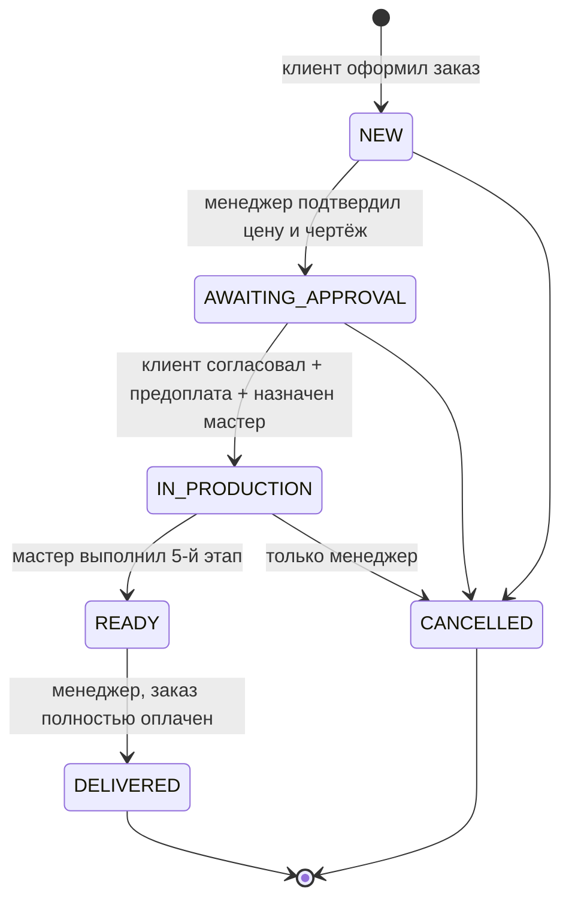

# Архитектура проекта «Лапа и доска»

Версия 1.1 · реализовано по этому документу · деньги в тенге (₸), страна — Казахстан.

## 1. Что за проект

Мастерская делает мебель для животных на заказ. Клиент выбирает изделие, задаёт размеры, материал и опции, сайт показывает цену и принимает заказ. Менеджер согласует заказ, мастер делает изделие по этапам, администратор ведёт каталог.

Стек: **React** (клиент) · **Express** (API) · **PostgreSQL** + **Prisma** (база) · **JWT** + **bcrypt** (вход) · **zod** (проверка данных).

## 2. Роли

| Роль | Что может | Чего не может |
|---|---|---|
| Гость | Смотреть каталог, считать цену в конфигураторе, регистрироваться, входить | Оформлять заказ (см. БП-7) |
| Клиент (`CLIENT`) | Оформлять заказы, видеть только свои, согласовывать цену, отменять заказ до производства | Видеть чужие заказы, менять цену и статусы производства |
| Менеджер (`MANAGER`) | Видеть все заказы, подтверждать цену, назначать мастера, отмечать оплату и выдачу, отменять заказ | Править каталог, менять роли |
| Мастер (`MASTER`) | Видеть только назначенные ему заказы в производстве, отмечать этапы | Менять цену, статус заказа вручную, видеть чужие заказы |
| Администратор (`ADMIN`) | Каталог, материалы, опции, пользователи и роли | Понизить последнего администратора |

## 3. MVP (7 функций)

1. Каталог изделий.
2. Конфигуратор: размеры + материал + опции → цена.
3. Оформление заказа (после входа).
4. Кабинет клиента: свои заказы, статус, история.
5. Кабинет менеджера: заказы, цена, мастер, оплата, выдача.
6. Кабинет мастера: этапы производства.
7. Админка: каталог, материалы, опции, пользователи.

**Расширение (не в MVP):** питомцы клиента, уведомления по почте и SMS, статистика и отчёты, отзывы, онлайн-оплата, отслеживание заказа без входа.

## 4. Статусы заказа и этапы мастера

Это два разных поля. **Статус заказа** (`status`) показывает, где заказ в целом: у менеджера, в цехе или у клиента. **Этап** (`ProductionStage`) — детальный шаг работы мастера внутри статуса «В производстве». Клиенту и менеджеру нужен общий статус, мастеру — этапы. Оплата хранится третьим полем (`paymentStatus`), потому что оплата и ход заказа независимы.

Статусы (`OrderStatus`): `NEW` Новый · `AWAITING_APPROVAL` На согласовании · `IN_PRODUCTION` В производстве · `READY` Готов · `DELIVERED` Выдан · `CANCELLED` Отменён.

Этапы (`StageType`): `DRAWING` Чертёж → `CUTTING` Распил → `ASSEMBLY` Сборка → `PAINTING` Покраска → `PACKING` Упаковка.

Оплата (`PaymentStatus`): `UNPAID` Не оплачен · `PREPAID` Предоплата 50 % · `PAID` Оплачен полностью.



### Таблица разрешённых переходов

| Из | В | Кто | Условия |
|---|---|---|---|
| — | `NEW` | Клиент | Вход выполнен; цена посчитана сервером |
| `NEW` | `AWAITING_APPROVAL` | Менеджер | Цена подтверждена (`finalPrice` задана) |
| `NEW` | `CANCELLED` | Клиент, менеджер | Клиент — только если `paidAmount` = 0 (БП-15) |
| `AWAITING_APPROVAL` | `IN_PRODUCTION` | Менеджер | Клиент согласовал (`clientApproved = true`), `paymentStatus` ≥ `PREPAID`, назначен мастер |
| `AWAITING_APPROVAL` | `CANCELLED` | Клиент, менеджер | Клиент — только если `paidAmount` = 0 (БП-15) |
| `IN_PRODUCTION` | `READY` | Система | Выполнены все 5 этапов (автоматически) |
| `IN_PRODUCTION` | `CANCELLED` | Менеджер | Указана причина |
| `READY` | `DELIVERED` | Менеджер | `paymentStatus` = `PAID` |

Согласие клиент даёт отдельным запросом `POST /orders/:id/approve` — он ставит `clientApproved = true`, статус не меняет. Запустить производство может только менеджер.

Любой другой переход сервер отклоняет с кодом 409. Назад из `DELIVERED` и `CANCELLED` не возвращаются. Каждый переход пишется в `OrderStatusHistory`.

## 5. Бизнес-правила

| № | Правило | Закрывает |
|---|---|---|
| БП-1 | Цену считает только сервер по формуле из раздела 6. Браузер присылает `productId`, размеры, `materialId`, `optionIds`, количество. Поле `price` из запроса игнорируется | Л-1 |
| БП-2 | В заказе хранится `productId` и снимок на момент заказа: название, размеры, материал, опции и цена. Изменение или архивирование товара не меняет старые заказы. Товары с заказами не удаляются, а архивируются (`isArchived`) | Л-2 |
| БП-3 | Статус меняется только по таблице переходов (раздел 4), роль проверяется на сервере. Есть статус `CANCELLED` | Л-3 |
| БП-4 | Деньги хранятся целым числом в тенге (`Int`). Статусы — enum. Пустое значение не подменяется нулём. `0` — допустимая цена только для опции | Л-4 |
| БП-5 | Мастер отмечает этапы только по заказам со статусом `IN_PRODUCTION`, назначенным ему, и строго по порядку. После 5-го этапа заказ автоматически становится `READY` | Л-5 |
| БП-6 | Назначить можно только пользователя с ролью `MASTER` и `isActive = true` | Л-6 |
| БП-7 | Заказ оформляет только вошедший клиент. Заказ всегда привязан к `clientId`, поэтому клиент видит его в кабинете. Отслеживание без входа — в «Расширение» | Л-7 |
| БП-8 | Выручка в админке и отчётах = сумма оплаченных сумм по заказам со статусом `DELIVERED` или `paymentStatus` ≥ `PREPAID`, кроме `CANCELLED` | Л-8 |
| БП-9 | Предоплата 50 % учитывается полем `paymentStatus` и суммой `paidAmount`. Менеджер отмечает оплату вручную. Запуск в производство без предоплаты запрещён | Л-9 |
| БП-10 | Нельзя понизить, заблокировать или удалить последнего активного администратора | Л-10 |
| БП-11 | Питомцы не входят в MVP. В заказе есть необязательное поле `petNote` (кличка и порода текстом) | Л-11 |
| БП-12 | Вместо «Уведомлений» в кабинете — «История заказа» из `OrderStatusHistory` | Л-12 |
| БП-13 | Клиент видит только свои заказы, мастер — только назначенные ему. Проверка на сервере по `userId` из токена, а не из запроса | — |
| БП-14 | Размеры изделия ограничены минимумом и максимумом, заданными в товаре. Сервер отклоняет значения вне диапазона | — |
| БП-15 | После внесения оплаты (`paidAmount` > 0) клиент сам отменить заказ не может, только менеджер. Менеджер при отмене сам решает вопрос возврата денег с клиентом вне системы; оплаченная сумма остаётся в `paidAmount`, но в выручку не входит (БП-8) | — |

## 6. Расчёт цены

Все суммы в тенге, целые.

```
объём_л        = ширина × глубина × высота / 1000          (размеры в см)
доплата_размер = max(0, объём_л − базовый_объём_л) × цена_за_литр
база           = basePrice + доплата_размер
с_материалом   = база × material.coefficientPercent / 100
цена_за_штуку  = с_материалом + сумма(option.extraPrice)
итого          = округление_до_100(цена_за_штуку) × количество
```

Эта цена — `estimatedPrice`, ориентировочная. Менеджер подтверждает её полем `finalPrice`. Предоплата считается от `finalPrice`: `ceil(finalPrice / 2)`.

## 7. База данных (Prisma)

```prisma
enum Role          { CLIENT MANAGER MASTER ADMIN }
enum OrderStatus   { NEW AWAITING_APPROVAL IN_PRODUCTION READY DELIVERED CANCELLED }
enum PaymentStatus { UNPAID PREPAID PAID }
enum StageType     { DRAWING CUTTING ASSEMBLY PAINTING PACKING }

model User {
  id           Int      @id @default(autoincrement())
  fullName     String
  email        String   @unique
  phone        String?
  passwordHash String
  role         Role     @default(CLIENT)
  isActive     Boolean  @default(true)
  createdAt    DateTime @default(now())
  ordersAsClient Order[] @relation("ClientOrders")
  ordersAsMaster Order[] @relation("MasterOrders")
}

model Product {
  id             Int     @id @default(autoincrement())
  name           String
  description    String
  category       String
  basePrice      Int            // ₸
  baseVolumeL    Int
  pricePerLiter  Int            // ₸ за литр сверх базового объёма
  minWidth       Int
  maxWidth       Int
  minDepth       Int
  maxDepth       Int
  minHeight      Int
  maxHeight      Int
  isArchived     Boolean @default(false)
  items          OrderItem[]
}

model Material {
  id                 Int    @id @default(autoincrement())
  name               String
  coefficientPercent Int    // 100 = без наценки
  isArchived         Boolean @default(false)
}

model Option {
  id         Int    @id @default(autoincrement())
  name       String
  extraPrice Int
  isArchived Boolean @default(false)
}

model Order {
  id             Int           @id @default(autoincrement())
  clientId       Int
  client         User          @relation("ClientOrders", fields: [clientId], references: [id])
  masterId       Int?
  master         User?         @relation("MasterOrders", fields: [masterId], references: [id])
  status         OrderStatus   @default(NEW)
  paymentStatus  PaymentStatus @default(UNPAID)
  estimatedPrice Int
  finalPrice     Int?
  paidAmount     Int           @default(0)
  petNote        String?
  address        String?
  clientApproved Boolean       @default(false)
  cancelReason   String?
  createdAt      DateTime      @default(now())
  items          OrderItem[]
  stages         ProductionStage[]
  history        OrderStatusHistory[]
}

model OrderItem {
  id           Int     @id @default(autoincrement())
  orderId      Int
  order        Order   @relation(fields: [orderId], references: [id])
  productId    Int
  product      Product @relation(fields: [productId], references: [id])
  productName  String  // снимок
  width        Int
  depth        Int
  height       Int
  materialName String  // снимок
  options      Json    // снимок: [{name, extraPrice}]
  unitPrice    Int     // снимок
  quantity     Int
}

model ProductionStage {
  id        Int       @id @default(autoincrement())
  orderId   Int
  order     Order     @relation(fields: [orderId], references: [id])
  stage     StageType
  doneById  Int
  doneAt    DateTime  @default(now())
  @@unique([orderId, stage])
}

model OrderStatusHistory {
  id        Int         @id @default(autoincrement())
  orderId   Int
  order     Order       @relation(fields: [orderId], references: [id])
  fromStatus OrderStatus?
  toStatus   OrderStatus
  changedById Int
  comment   String?
  createdAt DateTime    @default(now())
}
```

Связи: пользователь 1—N заказов (как клиент и как мастер); заказ 1—N позиций, этапов и записей истории; товар 1—N позиций заказа.

## 8. API

Префикс `/api`. Ответы — JSON. Ошибки: 400 данные неверны, 401 нет входа, 403 нет прав, 404 не найдено, 409 запрещённый переход.

| Метод | Путь | Роль | Что делает |
|---|---|---|---|
| POST | `/auth/register` | гость | Регистрация (роль всегда `CLIENT`) |
| POST | `/auth/login` | гость | Вход, возвращает JWT |
| GET | `/auth/me` | любая | Текущий пользователь |
| GET | `/products` · `/products/:id` | все | Каталог |
| GET | `/materials` · `/options` | все | Справочники для конфигуратора |
| POST | `/price/estimate` | все | Расчёт цены (раздел 6) |
| POST | `/orders` | CLIENT | Создать заказ (цена считается сервером) |
| GET | `/orders` | любая | Список: клиент — свои, мастер — назначенные, менеджер/админ — все |
| GET | `/orders/:id` | участник | Карточка заказа с историей и этапами |
| PATCH | `/orders/:id/price` | MANAGER | Подтвердить `finalPrice` |
| POST | `/orders/:id/approve` | CLIENT | Согласие клиента |
| PATCH | `/orders/:id/master` | MANAGER | Назначить мастера (БП-6) |
| PATCH | `/orders/:id/payment` | MANAGER | Отметить оплату |
| POST | `/orders/:id/transition` | MANAGER, CLIENT | Смена статуса по таблице (раздел 4) |
| POST | `/orders/:id/stages` | MASTER | Отметить следующий этап; в теле `{stage}` — защита от двойного нажатия (БП-5) |
| GET·POST·PUT | `/admin/products` · `/admin/materials` · `/admin/options` | ADMIN | Управление каталогом |
| PATCH | `/admin/<справочник>/:id/archive` | ADMIN | В архив / из архива (удаления нет, БП-2) |
| GET | `/orders/masters` | MANAGER, ADMIN | Список активных мастеров для назначения |
| GET·PATCH | `/admin/users` | ADMIN | Пользователи и роли (БП-10) |
| GET | `/admin/stats` | ADMIN | Выручка по БП-8 |

## 9. Страницы

| Страница | Путь | Роль |
|---|---|---|
| Главная и каталог | `/` | все |
| Карточка изделия с конфигуратором | `/products/:id` | все |
| Вход, регистрация | `/login` · `/register` | гость |
| Оформление заказа | `/checkout` | CLIENT |
| Мои заказы, карточка заказа | `/cabinet` · `/cabinet/orders/:id` | CLIENT |
| Заказы менеджера | `/manager/orders` · `/manager/orders/:id` | MANAGER |
| Мои заказы в цехе | `/master/orders` · `/master/orders/:id` | MASTER |
| Каталог, справочники, пользователи | `/admin/*` | ADMIN |

## 10. Безопасность

- **Пароли:** bcrypt (cost 10 и выше), хеши никогда не возвращаются в API.
- **Сессии:** JWT со сроком жизни 8 часов, секрет в `.env`. «Выйти» удаляет токен на клиенте; при блокировке пользователя сервер проверяет `isActive` на каждом запросе.
- **Перебор паролей:** `express-rate-limit`, не больше 10 попыток входа за 15 минут с одного IP.
- **Данные:** все входные данные проверяет zod; запросы к базе только через Prisma (защита от SQL-инъекций); React экранирует текст (защита от XSS).
- **Права:** проверка роли и владельца в middleware на сервере, скрытие кнопок в интерфейсе — только удобство.
- **Прочее:** `helmet`, CORS только для адреса сайта, `.env` не в репозитории, тестовые пользователи создаются seed-скриптом.

## 11. Структура репозитория

```
lapa-i-doska/
├── docs/architecture.md
├── client/            # React
├── server/
│   ├── prisma/schema.prisma
│   ├── prisma/seed.js
│   └── src/ (routes, middleware, services/pricing.js, services/orderStatus.js)
├── .gitignore
└── README.md
```

## 12. План разработки

1. Сервер: Prisma, регистрация и вход, роли.
2. Каталог и расчёт цены (`pricing.js` с тестами).
3. Заказы и таблица переходов (`orderStatus.js` с тестами).
4. Этапы мастера и оплата.
5. Админка.
6. Клиент: страницы по ролям.
7. Проверка безопасности и демонстрация.

## 13. Ответы на вопросы для самопроверки

1. **Заказ с `"price": 1`:** сервер игнорирует поле, считает цену сам по БП-1 и сохраняет её; клиент получает настоящую цену.
2. **Подорожание будки:** вчерашний заказ не меняется, потому что хранит снимок цены (БП-2).
3. **Распил при статусе «На согласовании»:** нет. Проверка в `POST /orders/:id/stages` на сервере: заказ должен быть `IN_PRODUCTION` и назначен этому мастеру (БП-5).
4. **Статус и этап:** статус — состояние заказа для всех ролей, этап — шаг работы мастера внутри «В производстве». Два поля нужны, чтобы клиенту не показывать детали цеха, а мастеру не давать менять общий статус.
5. **SHA-256 для паролей:** он быстрый, и перебор миллиардов вариантов в секунду реален; нет соли, одинаковые пароли дают одинаковый хеш. bcrypt медленный и с солью.
